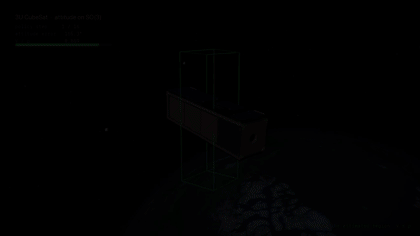
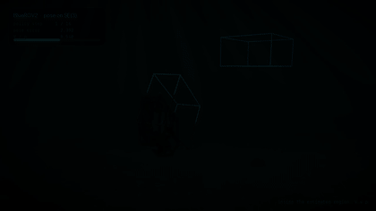

# Learning Maximal Lyapunov Functions for Deep Reinforcement Learning-based Controllers on Matrix Lie Groups

Hamza Tariq, Matthieu Barreau and Adeel Akhtar

**Project page: https://gradslab.github.io/maxlyap_lie_rl/**

A deep RL policy steers an element of a matrix Lie group (SO(2), SO(3), SE(2), SE(3)) to a goal. It observes the
state-to-goal error and commands a bounded body velocity, so one closed loop describes it for every goal. For such a
trained policy we learn its accumulated cost, the undiscounted sum of squared distances to the goal, from its one-step
equation, and take a sublevel set as an estimate of the region of attraction. When an actuator gain error or misalignment
is identified, the region is recomputed for the same policy without retraining it.

<p align="center">


</p>

## Layout

```
lie_rl/     package (groups, environment, PPO/TRPO/SAC/TD3, candidate, level rule) and scripts
            results/  policies, candidates and the result files behind every table, figure and number
deploy/     MuJoCo models and runs of the CubeSat and the BlueROV2
paper/      builders of the tables, figures and numbers of the paper, and the paper's versions for comparison
pipeline/   job lists of the full computation, stage by stage, and the queue that runs them
render/     the animations of the project page
docs/       the project page
```

## Reproduce

Python 3.12 on macOS or Linux. The renders also need ffmpeg.

```sh
git clone https://github.com/gradslab/maxlyap_lie_rl.git && cd maxlyap_lie_rl
bash reproduce.sh setup      # two virtual environments: .venv and .venv-deploy (MuJoCo)
bash reproduce.sh tables     # every table, figure and number of the paper from lie_rl/results, compared with the paper
```

`tables` takes a few minutes. It writes `paper/out/` and ends with `paper/compare.py`, which checks every table line by
line and every figure pixel by pixel against `paper/reference/`, and `paper/text_numbers.py`, which checks the numbers of the
text. Panels (a) and (b) of Figure 1 are 3D renders kept as a vector file in `paper/assets/`; `paper/make_fig1.py data`
and `paper/make_fig1_v4.py` (pyvista) rebuild them.

```sh
bash reproduce.sh check      # stability test of the 48 policies and the SO(2) interval proofs, from the checkpoints
bash reproduce.sh renders    # the animations of the project page
bash reproduce.sh all        # the full computation from scratch, then the tables
bash reproduce.sh stage 07_second_search   # one stage
```

`all` trains the 48 policies and runs every stage in `pipeline/jobs/` on 4 lanes of 2 threads, skipping any output that
exists. On an 8-core laptop it takes about ten days. The stages are:

| stage | content |
|---|---|
| 00 | 48 policies: PPO, TRPO, SAC, TD3, 3 seeds, 4 groups |
| 01 | stability test, policy evaluation |
| 02 | candidate, refinement and level rule on the 39 stable policies and 8 loops with an actuator error; oracle regions |
| 03 | screens of the closed loops with an actuator error |
| 04, 05 | the other 47 closed loops with an actuator error |
| 06 | ablations, candidate seeds, auxiliary evaluations |
| 07 | second independent search of every level; SO(2) interval proofs |
| 08 | neural Lyapunov baseline on the 55 closed loops with an actuator error |
| 09 | sensitivity to the radii, near-goal decrease, vehicle runs with body rates and a halved period |
| 10 | BlueROV2 on the 28 SE(3) closed loops with an actuator error |
| 11 | CubeSat and BlueROV2 runs |

## Citation

```bibtex
@unpublished{tariq2026maximal,
  author = {Hamza Tariq and Matthieu Barreau and Adeel Akhtar},
  title  = {Learning Maximal {L}yapunov Functions for Deep Reinforcement
            Learning-based Controllers on Matrix {L}ie Groups},
  note   = {Under review},
  year   = {2026}
}
```

The CubeSat model is the MiRaTA 3U CubeSat of NASA 3D Resources, the Earth texture is NASA Blue Marble, and the BlueROV2
Heavy meshes are under the license in `deploy/underwater/assets/bluerov2_heavy/`.
